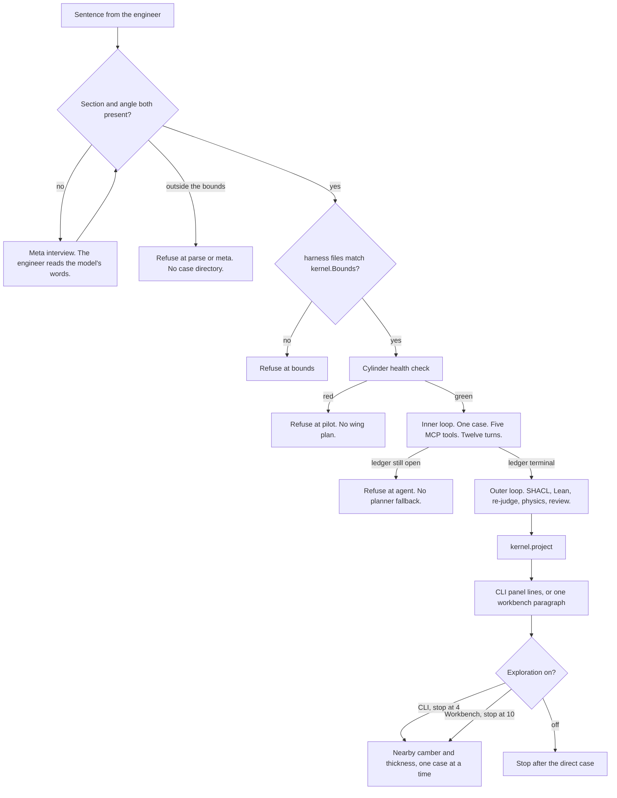
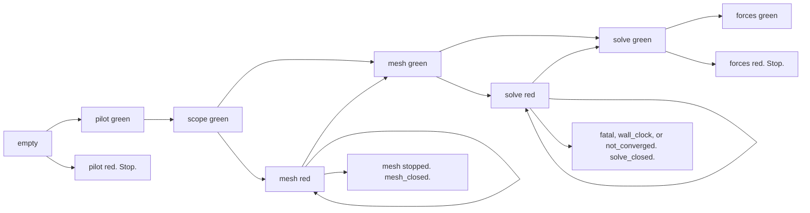

# Wingline

| | |
|---|---|
| Author | Saarthak Bhatia |
| Date | 2026-10-26 |
| Status | As built |
| Repository | https://github.com/thewalkingperson/vertical-labs (private) |

This page is the system as it runs. It is written so a senior engineer, or a reviewer of the take-home, can run it and can see what a result is allowed to mean. Receipts are the evidence. Agent prose is not.

The longer internal contract is `DESIGN.md`. `IMPLEMENTATION_PHYSICS.md` is a closed brief. Do not copy a withdrawn wall-resolved claim, an old lift band, or an iteration-600 coefficient out of either file and treat it as the current solver result. Where the previous README disagrees with the code, this page follows the code.

## Overview

Wingline answers one question: is this NACA 4-digit section worth a finer airflow simulation?

You ask in a sentence. Three loops handle it. The meta loop interviews when the section or the angle is missing. The interview is the model's words. The inner loop drives one case through five MCP tools until the receipt ledger is finished or refused. The outer loop grades that case from the ledger, then can search nearby camber and thickness. A screening is permission to consider a finer mesh. It is not a design grade, and it is not a release for flight hardware.

The customer sentence is:

```text
NACA 2412 at 6 degrees. Is this worth a finer run?
```

On the current nose and iteration count, that case has been run and refused. The numbers are in [Measured results](#measured-results). They are not a design grade.

## Background and motivation

A coarse wing study by hand is a pile of dictionaries, a mesh that may be illegal, and a transcript that can quote a lift number after a failed check. Wingline will not treat that number as a result unless every prior gate is a green receipt. `kernel.project` is the only function that builds a `Screening` or a `DesignGrade`. `hardware_decision` accepts only a `DesignGrade`.

The flight-air case is serial `simpleFoam`, wall-modeled Spalart-Allmaras, on a mesh that is one cell thick. Viscosity is `1.5e-5`. The supported Reynolds-number range is `1e5` to `5e6`. There is one model in that range. There is no low-Reynolds branch and no thin-airfoil acceptance.

The production opening mesh clusters the leading edge at chordwise ratio 16 and runs 1500 iterations. The solve is refused as `not_converged` when the mean lift or the mean drag of the last 100 iterations differs from the previous 100 by more than `1e-4`. A ratio-16 parent of NACA 2412 at 6 degrees and 10 m/s reached iteration 1500 and was refused on lift drift. The finer mesh was not run. The saved fixture is an older nose, stopped at iteration 600. It still replays. It is not the result of the current setup.

## Goals and non-goals

**Goals**

- Accept one NACA 4-digit section inside the bounds below, or refuse it at a named gate before a case exists.
- Mesh and solve that one section with the wall-modeled setup in `wingline/case_writer.py`.
- Admit a receipt only when the legal prefix allows it. The judge sets green, red, or stopped. The model does not.
- Compare measured lift with NeuralFoil 0.3.3, free transition, and refuse when the reference is missing, low-confidence, or outside the band.
- Mint a design grade only when a parent screening was worth a finer run and the refined child stays inside the force-delta bounds.
- Show the command line as panel lines, and a finished workbench study as one paragraph from `wingline/brief.py`.

**Non-goals**

- Mesh independence. The child is a 20% chordwise check.
- A flight-hardware release. `hardware_decision` will not accept a screening.
- An absolute drag comparison with NeuralFoil. There is no Cd gate against the polar.
- A requirement that y+ be below 1.
- A laminar, transitional, or low-Reynolds solver branch.
- Fixing the two solver limits in [Known limits](#known-limits). They are left as they are.
- Any new product work. The only change this document asks for is replacing `README.md` with this text.

## Proposed design

### Three loops



**Meta.** `wingline.meta.resolve` parses a complete sentence and does not call the model. If the section or the angle is missing, and the request is still about a wing, Grok interviews under `META_SYSTEM` in `wingline/prompts.py`. The engineer reads the model's `say`. If that reply is missing or unusable, the harness asks with a short gap sentence instead of inventing an angle. A code the model settles on still has to pass the wing bounds before a case starts. The model does not choose an angle. Speed, chord, and span stay at the defaults until the engineer names them. Questions and answers are appended to `runs/meta/dialogue.jsonl`. Four turns is the cap. If the interview does not settle, the gate is `meta`.

A follow-up can reuse the last section. `Same wing at 8 degrees`, or a later angle or speed that does not name a new wing, reads `runs/last_spec.json`. A new named NACA sentence starts fresh. It does not keep the previous section.

Between runs, `wingline.meta.propose` can still ship one structural fix. The templates that actually ship are a stricter bound (`_try_bound`), a denied tool (`_try_deny`, appended to `harness/deny-tools.txt`), a replay test (`_try_replay`), and a skill draft for a human (`_skill`, a markdown file under `runs/meta/proposals/`). `_try_shacl` and `_try_lean` always return `None`, and `propose` discards those return values. A correction that asks for a required receipt field or a Lean guard does not change `harness/shapes/receipt.shacl.ttl` or `harness/gate/Gate.lean`. It falls through to a later template, or to the skill draft. The comments in those two functions say there is nothing to ship and not to add a constructor. A stricter bound is the path that does rewrite the two policy files: it edits one `Bounds` field and then runs `emit`. It cannot loosen `max_skew`, `delta_cl`, or `delta_cd`. It cannot mark a CFD run as passed. A looser correction matches no template.

**Inner.** One case, one lease, five tools. The driver is the agent unless `WINGLINE_AGENT=0`. Unset means the agent. `0` selects `wingline.planner` and is not an automatic fallback. If the agent exits with the ledger still open, the run refuses at gate `agent`. `runs/<id>/inner.json` records why. `agent.log` has the session output. Twelve turns is the cap (`Bounds.max_agent_turns`).

The agent is one headless Grok process: `grok-4.7`, reasoning effort `xhigh`, `--max-turns 12`, `--no-subagents`, `--trust`, with the five `wingline__*` tools allowed and shell, file, and web tools denied. `--permission-mode dontAsk` alone is not enough. A nested Grok session is expensive. Do not start a second solve while one is running. `Engineer.open` holds `runs/engineer.lock` until the process exits. A second open on that store raises.

**Outer.** `wingline.outer.evaluate` reads the ledger and the case. It does not read the agent transcript. First failure wins:

1. Emitted policy differs from `wingline/kernel.py` → `bounds`.
2. pySHACL on `outer/graph.jsonld` → `shacl` if the tool is missing or the shape fails.
3. Lean on `harness/gate/Gate.lean` → `lean` if the tool is missing or the proof fails. `WINGLINE_VERIFY_LEAN=0` skips this step.
4. Re-judge every receipt with the same `judge_*`. Disagreement refuses at that stage.
5. An inner red or stopped receipt refuses at that stage. No reviewer. `verdict.json` still records `physics: red` and `review: challenge` on this stop. Those two fields are placeholders. They are not a NeuralFoil judgment and not a review.
6. `judge_physics`. Red → `physics`. That file omits `gate`. `review: challenge` on it is written because the reviewer was not called.
7. Review, only when physics is green and `WINGLINE_AGENT` is not `0` and `grok` is on `PATH`. The reviewer runs in a scratch directory with no tools and no file access. Affirm or challenge. Unparseable output is challenge. If `WINGLINE_AGENT=0`, or `grok` is missing, `_review` returns `challenge` and does not write `outer/review.json`. `evaluate` still stores `physics` `green` and `review` `challenge`. `project` then mints a `Screening` with `worth_finer` false. A challenge is not `Refused at gate review`.

`kernel.project` then builds the view. After the direct result, the outer search runs nearby sections, one at a time, through the same gates. The command line stops at 4 (`EXPLORE_BUDGET`). The workbench, when the switch is on, stops at 10 (`EXPLORE_CAP`) and uses the tool client for those neighbors only. The angle you named stays fixed. The search ranks on the aim in the sentence: lower drag, higher lift, or, when you did not name an aim, higher lift over drag. A better neighbor is reported with its gate. That report is not a hardware decision.

### Receipt order

Stages on a receipt are `pilot`, `scope`, `mesh`, `solve`, `forces`. Status is `green`, `red`, or `stopped`. `admit` appends a receipt only when `(stage, status)` is in `NEXT[shape(ledger)]`. A green forces receipt after a red or stopped prefix is not a legal row.



`mesh_open` allows another mesh attempt while the mesh budget (3) remains and the evidence signature is new. A repeated signature may only be followed by `stopped` with why `repeated_mesh`. The third red mesh with a new signature may only be followed by `stopped` with why `budget`. `solve_open` is the same idea with budget 2, and only for failure `residual`. `budget` is that stop why. It is not a refusal gate. `project` still refuses at the stage, `mesh` or `solve`. `fatal`, `wall_clock`, and `not_converged` close the solve immediately. The planner stops on those three. It does not spend the residual budget on them.

Ledger append is: write `ledger/<id>.json`, fsync, append one line to `ledger/index.jsonl`, fsync, under `flock` on `runs/<id>/case.lock`. `admit` returns the existing receipt when the idempotency key was already committed, and writes nothing when the edge is absent.

### What you can ask

| Input | Result |
|---|---|
| `NACA 2412 at 6 degrees. Is this worth a finer run?` | 2412, 6 degrees, 10 m/s, chord 1 m, span 0.1 m, coarse |
| `NACA 2412 at 6 degrees and 15 m/s.` | Speed 15 m/s |
| `NACA 0012 with chord 0.5m at 4 degrees and 15 m/s.` | Chord and speed set. Span can be `span 0.2m` or `depth 0.05m`. |
| `Same wing at 8 degrees.` | Last section, speed, chord, and span. New angle. No previous spec → parse refusal. |
| `a wing with low drag at 10 degrees` | Interview. The section is missing. The model's words ask for it. |
| `NACA 2412 at 40 degrees.` | Parse refusal. Angle outside [-2, 10]. No case directory. |
| `NACA 9999 at 6 degrees.` | Parse refusal. Thickness digit outside 6..24. |

Bounds, all from `Bounds` in `wingline/kernel.py`:

| Name | Value |
|---|---|
| Angle | [-2, 10] degrees |
| Speed | [5, 25] m/s, default 10 |
| Chord | [0.01, 100] m, default 1 |
| Span | [0.001, 50] m, default 0.1 |
| Thickness digit | 6..24 |
| Reynolds number | `speed * chord / nu`, accepted only in `1e5..5e6` |

Span is the thickness of the two-dimensional mesh, the `z` extent. It is not an airplane wingspan. The far field, `lRef`, and `Aref` scale with the lengths you name. A Reynolds number outside `1e5..5e6` is refused. The request does not open a case.

An incomplete request is interviewed. A request that names a number outside the table is refused at `parse`, with the reason in the goal line. The model is not asked to talk that number back into range.

### Physics

Serial `simpleFoam`. RAS Spalart-Allmaras. Newtonian `nu = 1.5e-5`. Reference density `rhoInf = 1`. Default speed 10 m/s and chord 1 m give Reynolds number 666667. The wall condition is `nutUSpaldingWallFunction`: Spalding's blended wall function, valid across the sublayer, the buffer, and the log region. It is not a log-layer-only condition. y+ is written at the end of the solve and recorded on the solve receipt. It is not required to be below 1, and it is not a gate.

The parent mesh is stream 100, grading 8, `n_normal` 160, wall-grading ratio 1000 (`grading * 125`), and 64000 cells. Six hex blocks. `n_chord` is `stream` on a coarse mesh and `2 * stream` on a refined mesh. Cells are `4 * n_chord * 160`. The first chordwise cells are clustered at the nose: ratio 16 on the upper lead block, and 1/16 on the lower lead block, because that block's chord axis runs toward the nose. The first wall-normal cell is about 0.000340 m on a 1 m chord. That height is the first step of a ratio-1000 grading across the far-field height, `8 * chord`, and it scales with chord. The mesh receipt on a 1 m chord stores `first_cell_m` 0.000340444. The section is drawn at geometric angle 0. Angle of attack is the freestream in `0/U`.

The refined child, when it is run, is stream 60 and density `refined`: 76800 cells, 120 chordwise cells. That is 20% more chordwise cells than the parent. It is not a doubled copy of stream 100, which would be 200 chordwise cells. It is a local mesh check, not mesh independence.

`endTime` is 1500 and `deltaT` is 1. Volume fields are written every 20 steps and 10 are kept. `forceCoeffs` still writes every step. A `forces` function object and a `yPlus` function object write once, at iteration 1500. `yPlus` sets `writeFields false`.

Force drift: the mean Cl and the mean Cd of the last 100 iterations versus the previous 100 must each be `<= 1e-4`. Otherwise `commit_solve` sets `failure` to `not_converged` and the solve closes. Local continuity must be `<= 1e-4`. Cumulative continuity `5e-3` is only a fallback for an old log that has no local value. `residualControl` is `1e-5` on `p`, `U`, and `nuTilda`. See [Known limits](#known-limits).

Mesh gates: `Mesh OK`, cell count equal to `cell_count`, `max_skew` 4, `max_non_ortho` 65. The solve process cap is 1800 s. The `commit_solve` tool allowance is 2100 s, so a receipt can still be written if the process hits the cap. Mesh process cap 90 s, tool allowance 120 s. Cylinder pilot cap 180 s.

Reference area is not 1. In `_control`:

```python
aref = c * span
cofr = (0.25 * c, 0.0, 0.0)
# lRef = c, Aref = aref, CofR = cofr, rhoInf = 1
```

Default chord 1 m and span 0.1 m give `Aref = 0.1` and `lRef = 1`. With `rhoInf` equal to the coefficient density, `Aref = chord * span` makes Cl a per-unit-span coefficient. `Aref = 1` would shrink Cl by 10× on the default mesh. `liftDir` is `(-sin α, cos α, 0)` and `dragDir` is `(cos α, sin α, 0)`, with α in radians. The parser reads `Cl` and `Cd` by header token, last data row, never by a fixed column index.

`Cd(f)` and `Cd(r)` in `coefficient.dat` are the front and rear axle. They are not pressure and viscous. `cd_pressure` and `cd_viscous` come from the `forces` function object. They are context, not a gate.

NACA ordinates use a closed trailing edge, coefficient `-0.1036`. The polyline sample count is 80. Cell count does not follow that sample count.

```text
yt = 5 t (0.2969 √x - 0.1260 x - 0.3516 x² + 0.2843 x³ - 0.1036 x⁴)
```

Schemes are steady-state, `bounded Gauss linearUpwind` on `U` and `nuTilda`, `Gauss linear` on the deviatoric term, laplacian `Gauss linear corrected`, wall distance `meshWave`. `fvSolution` uses GAMG on `p` (tolerance `1e-6`, relTol 0.1) and `smoothSolver` Gauss-Seidel on `U` and `nuTilda` (tolerance `1e-8`, relTol 0.1, two sweeps). Relaxation is `p` 0.3, `nuTilda` 0.7, and `U` from the plan. The opening plan is `u_relax` 0.5 and one non-orthogonal corrector. `0/nuTilda` is `3 * nu` in the freestream and 0 on the wall. There is no `decomposePar` and no `snappyHexMesh`. The case does not copy the `airFoil2D` tutorial mesh and does not run its `Allrun`.

The cylinder health check is the stock `potentialFoam` cylinder tutorial. It must report 2000 cells, continuity `<= 5e-4`, and interpolated velocity error `<= 5e-5`. A green result is reused while the `openfoam` path and the tutorial `Allrun` hash are unchanged.

### Lift gate and design grade

NeuralFoil 0.3.3, through AeroSandbox 4.2.10, is the external lift reference. `wingline/reference.py` calls `neuralfoil.get_aero_from_airfoil`. It does not import the rest of Wingline, and it does not import NeuralFoil until the call. The lift reference is the free-transition polar, `xtr = 1`. The band is `max(0.03, 0.05 * abs(Cl_ref))`. Confidence must be at least 0.90. A missing install, a non-finite value, an out-of-range Reynolds number, or a confidence below 0.90 fails closed. There is no second model.

The forced-transition polar (`xtr = 0`) is recorded beside the free-transition polar after the free-transition confidence clears the floor. It is not a pass or fail. On the cases checked here its confidence is about 0.26, which is below 0.90.

Absolute Cd is not compared with NeuralFoil. Cd must be positive. Mesh-to-mesh drag still uses `delta_cd` 0.01. Reference Cd, the forced-transition Cd, `cd_pressure`, and `cd_viscous` are context.

The screening sentence, exact, is:

```text
This mesh is not a design answer until the refinement gate passes.
```

The design grade sentence, exact, is:

```text
Design grade is force agreement between the parent mesh and a 20% chordwise refinement on this wall-modeled Spalart-Allmaras setup. It is not mesh independence and it is not a flight-hardware release.
```

`hardware_decision` returns a decision only when its argument's type is `DesignGrade`. A screening and a refusal both raise `TypeError`. `DesignGrade.__post_init__` rejects a delta outside `delta_cl` 0.05 or `delta_cd` 0.01. `refine` creates a child run only when the parent outcome is a `Screening` with `worth_finer` true. Otherwise the gate is `commission` and no child case is written. The child is a new run, density `refined`, same section, angle, speed, chord, and span. The parent case is not modified.

`project` mints `worth_finer` only when the outer review is `affirm`. A challenge is still a screening, and it is not a commission. No outer verdict is gate `incomplete`. Physics red is gate `physics`, and the view has no coefficient field. The CLI refusal line for physics appends the reason. Other refusal lines name the gate and the log. They do not print Cl.

### Measured results

Three different results exist. They are not interchangeable.

**1. Saved fixture. Older nose, iteration 600. This is the replay.**

`fixtures/naca2412-a6/`. `WINGLINE_FIXTURE=1` replays the parent ledger and `outer_affirm.json`. It does not start OpenFOAM and it does not start Grok. It prints a screening.

| Run | Cl | Cd |
|---|---:|---:|
| Parent, stream 100 coarse, 64000 cells | 0.882459 | 0.028414 |
| Child, stream 60 refined, 76800 cells | 0.855950 | 0.028031 |

The files store parent Cl 0.882458973 and Cd 0.0284136587, and child Cl 0.855949564 and Cd 0.0280312507. The fixture solve receipt records `end_time` 600. That pair passed the lift band and the force delta (`delta_cl` about 0.0265, `delta_cd` about 0.00038, both inside 0.05 and 0.01). It is a screening-to-design result for that older mesh. It is not the result of the ratio-16, 1500-iteration setup. A lift of 0.2313 is outside the NeuralFoil band and the physics gate refuses it. The same gate accepts the two fixture lifts above. There is no second model that can accept both.

The command-line fixture prints panel lines. The screening line rounds the parent to four digits:

```text
goal: NACA 2412 at 6 degrees, 10 m/s, coarse.
meshing: stream 100, grading 8.
mesh accepted: 64000 cells. Log: log.checkMesh
solving: simpleFoam.
screening: Cl=0.8825 Cd=0.0284. This mesh is not a design answer until the refinement gate passes.
```

Read that as a replay of the fixture, not as a live solve.

**2. Ratio-16 parent. NACA 2412, 6 degrees, 10 m/s, 1500 iterations. Not a design grade.**

This is the current nose. The parent finished 1500 iterations in 227 seconds. The finer mesh was not run.

| Point | Cl | Cd |
|---|---:|---:|
| Iteration 600 | 0.8955 | 0.02785 |
| Iteration 1500 | 0.9000 | 0.02691 |

Lift drift 0.00146. Drag drift 0.000029. The lift drift is above `1e-4`, so the solve was refused as `not_converged`. Pressure Cd was 0.0153 and viscous Cd was 0.0117. Those two numbers are the `forces` split. They are not `Cd(f)` and `Cd(r)`. The mesh passed: skew 2.58, non-orthogonality 63.8. y+ was about 1.2 to 13.2. Free-transition NeuralFoil at this point is about Cl 0.8989 and Cd 0.0100. NeuralFoil Cd is context. This run is not a design grade.

The command line for that refusal is panel lines, and it does not print the coefficients:

```text
goal: NACA 2412 at 6 degrees, 10 m/s, coarse.
meshing: stream 100, grading 8.
mesh accepted: 64000 cells. Log: log.checkMesh
solving: simpleFoam.
refused: Refused at gate solve. Log: log.simpleFoam
```

**3. Open workbench case. NACA 2412, 3 degrees, 10 m/s. Same nose, 1500 steps. Refused.**

The mesh passed: 64000 cells, stream 100, grading 8, wall grading 1000, first cell 0.000340444 m, skew 2.58, non-orthogonality 63.8. The section stays at geometric angle 0. The freestream stored in `0/U` is `(9.986, 0.523, 0)`, which is 10 m/s at 3.00 degrees. The file stores `9.98629534755` and `0.523359562429`. paraFoam shows that case.

The last row of `coefficient.dat` is Cl 0.5944 and Cd 0.02068. The page reports that as lift 0.594 and drag 0.0207. The solve receipt records lift drift about 0.00017 (`0.00016855`) and drag drift about 0.000016 (`1.626e-5`), over 1500 iterations, failure `not_converged`. Local continuity on that receipt is about `8.9e-8`, inside `1e-4`. The refusal is the lift drift, not the continuity bound. The receipt records y+ from about 1.04 to 10.4, average about 5.16. That range is this case. It is not the 1.2 to 13.2 range from the 6 degree run. y+ is not a gate.

NeuralFoil at this point is about Cl 0.607 and Cd 0.0071, confidence about 0.97. Absolute Cd is not a gate.

The workbench does not print the panel lines. `engineer_brief` in `wingline/brief.py` writes one paragraph. For this refusal the paragraph is:

```text
I ran the NACA 2412 at 3 degrees and 10 m/s on the coarse mesh. The mesh passed, with 64,000 cells at stream 100 and grading 8. simpleFoam completed 1,500 steps. Lift is 0.594 and drag is 0.0207. Drag has settled, within 0.00002. Lift is still moving by 0.00017, and the limit is 0.0001, so I am refusing the solve.
```

The page rounds drag drift to five digits, so `0.000016` is shown as `0.00002`. The receipt is the measurement. If paraFoam opened, the paragraph adds: `I have the case open in paraFoam.`

An earlier 204800-cell probe, not this nose and not this iteration count, measured Cl 0.7235 at 600 iterations and Cl 0.769 at 1200. That family misses `delta_cl` 0.05. It is not the production mesh. Do not raise the parent stream to 120 and do not raise `n_normal` to 320 to chase it.

### Known limits

These are limits of the solver harness. They are not a build backlog.

**`residualControl` can end `simpleFoam` before iteration 1500.** The stop is `1e-5` on `p`, `U`, and `nuTilda`. The drift check then uses the history that was written. A history shorter than 200 rows has no drift, and `commit_solve` refuses that as `not_converged` as well. A full 1500-iteration history is what the two measured refusals above actually produced. The early-exit path is still in `system/fvSolution`.

**A second solve in the same case can judge the first force file.** `commit_solve` reads `postProcessing/forceCoeffs/0/coefficient.dat` and no other name. OpenFOAM leaves that file in place and writes `coefficient_0.dat` for the next solve. The drift check keeps reading the unsuffixed file. `not_converged` closes the solve, so the planner does not take this path. A residual red can. The budget for that red is 2.

**`tests/test_import_boundary.py` fails on this tree.** `wingline/brief.py` imports `parse_force_coeffs` from `wingline/case_writer.py`. The test expects that import only from `wingline/mcp_server.py`. The import does not start OpenFOAM. `tests/test_openfoam_boundary.py` passes: the launcher name appears only in `case_writer.py`. Offline `pytest` on this tree is 100 passed, this 1 failed, and 1 skipped (`tests/test_live_2412.py`, which starts OpenFOAM only when `WINGLINE_LIVE=1`).

## API and interfaces

The command line still prints panel lines. It does not speak one paragraph.

```bash
python -m wingline "NACA 2412 at 6 degrees. Is this worth a finer run?"
```

`panel_lines` in `wingline/__main__.py` emits only these kinds: `goal`, `meshing`, `mesh accepted`, `solving`, `screening`, `design`, `refused`. A mesh refusal stops before `solving`. A solve refusal includes `mesh accepted` and `solving`, then `refused`, and no Cl. A physics refusal names the gate and appends the NeuralFoil reason. There is no coefficient on a refusal view.

The workbench is `python -m wingline.web`, bound to `127.0.0.1:8765`. A finished study is one paragraph from `wingline/brief.py`. The thinking row still narrates the live step: who is working (meta, inner, or outer) and the current OpenFOAM step. It is not the grade.

Constant exploration defaults on. The checkbox in `web/index.html` starts checked, and `Workbench` starts with the switch on unless `WINGLINE_EXPLORE=0`. `runs/explore.json` overrides that and is kept across a restart. When the switch is on, the page solves the asked wing, then up to 10 neighbors with the tool client (`WINGLINE_AGENT=0` only around those asks). Those neighbors do not add chat lines. They are full serial solves. The command-line search still stops at 4 and prints its lines. `WINGLINE_EXPLORE=0` skips the command-line search. Turn the switch off before a question if you do not want the extra solves.

Restarting `python -m wingline.web` calls `clear_session`. That deletes the chat, `last_spec.json`, `observe.jsonl`, `meta/`, and every `run-*` directory. The cylinder cache under `runs/pilot/` and `runs/explore.json` stay. Reset, beside Send, clears the transcript only. An open question stays on screen. A study that is already running keeps going.

Send starts a study when the page is idle, answers meta when it is asking, and steers the open run otherwise. `stop` ends the tool loop before the next OpenFOAM command. `grading 12` or `stream 80` during meshing, and `relax 0.5` or `non-ortho 1` during solving, apply when they are in the allowed set. The allowed mesh knobs are stream 60, 80, or 100, and grading 2, 4, 8, or 12. The allowed solve knobs are `u_relax` 0.7, 0.5, or 0.3, and `non_ortho` 0, 1, or 2.

The side canvas is a sketch from `wingline/picture.py`. The section stays level. A wind arrow shows the angle. Pressure and speed are the two fields, and the force history sits under the mesh. That picture is not ParaView.

`paraFoam` opens ParaView on the asked case. A finished direct case opens it once. The button posts the same opener. `open_parafoam` in `case_writer.py` runs `paraFoam -vtk -touch` and then a fixed ParaView script. In that window the mid-span slice is colored by speed, and the wing surface is colored by pressure. Specs are `spec.json` on the page, not a text card in ParaView. The X and Y components of `U` are the freestream. The Information tab shows bounds and cell count. Run the finer mesh is shown only when `worth_finer` is true.

One writer starts OpenFOAM: `wingline/case_writer.py`, and only as `["openfoam", "-c", snippet]` with `start_new_session=True` and no `shell=True`. The snippets are fixed strings: `blockMesh` and `checkMesh`, `simpleFoam`, `postProcess -func forceCoeffs`, and the cylinder `Allrun`. No model text is concatenated into a dictionary or a snippet. `wingline/mcp_server.py` is the only tool server. It is the module the import test allows to import the case writer. `brief.py` also imports the coefficient parser, as noted above. Nothing else starts the solver.

Five MCP tools, server name `wingline`:

| Tool | Effect |
|---|---|
| `observe` | Open stage, budgets, last receipt, and at most 40 lines of log tail when the last receipt is red |
| `commit_spec` | Renders the spec already on the run. No NACA argument. |
| `commit_mesh` | `stream` and `grading` enums only. `blockMesh` and `checkMesh`. |
| `commit_solve` | Re-renders `fvSolution` and runs `simpleFoam`. |
| `commit_forces` | Parses `coefficient.dat`. Runs the fixed `postProcess` snippet only if that file is missing. |

`perform_pilot` is not a tool. A bad lease writes nothing (`hmac.compare_digest`). A `run_id` that escapes the store is a tool error. Tool allowances in `.grok/config.toml`: observe 10 s, `commit_spec` 30 s, `commit_mesh` 120 s, `commit_solve` 2100 s, `commit_forces` 60 s.

Public Python surface, from `wingline/__init__.py`:

```python
from pathlib import Path
from wingline import Engineer, hardware_decision

eng = Engineer.open(Path("runs"))
view = eng.ask("NACA 2412 at 6 degrees. Is this worth a finer run?")
graded = eng.refine(view.run_id)
decision = hardware_decision(graded.outcome)
```

`ask` returns only after the outer loop has written a verdict, or after an earlier refusal. `refine` returns `commission` when the parent was not worth a finer run. `hardware_decision` raises `TypeError` unless `graded.outcome` is a `DesignGrade`.

There is no `GateName` type. `Refusal.gate`, the name on `Refused at gate …`, is one of `pilot`, `parse`, `scope`, `mesh`, `solve`, `forces`, `physics`, `commission`, `refinement`, `incomplete`, `lean`, `shacl`, `bounds`, `agent`, or `meta`. `review` is not one of those. It is the outer verdict, `affirm` or `challenge`. `budget` is not one of those either. It is the why on a stopped mesh or solve receipt.

Policy files `harness/shapes/receipt.shacl.ttl` and `harness/gate/Gate.lean` are emitted from `wingline/kernel.py`. A mismatch refuses at `bounds`. A normal question does not regenerate them.

```bash
.venv/bin/python -m wingline.kernel --emit
```

The Lean file proves three statements over the emitted table, by cases: a screening or design label is unreachable if any prior gate is red or stopped; design requires the refinement green, the delta inside the bound, and review affirm; a challenge review is not design.

## Data model

There is no database. The store is a directory, default `runs/`, override `WINGLINE_STORE`. `runs/` is gitignored.

| Path | Writer | Readers |
|---|---|---|
| `runs/engineer.lock` | `engineer.py` | — |
| `runs/<id>/lease` | `engineer.py`, mode `0600` | `case_writer` |
| `runs/<id>/spec.json` | `engineer.py` | tools, page, picture |
| `runs/<id>/case/` | `case_writer.py` | read |
| `runs/<id>/ledger/` | `case_writer.py` | outer, `project` |
| `runs/<id>/outer/verdict.json` | `outer.py` | `project` |
| `runs/<id>/outer/search.json` | `outer.explore` | the comparison board |
| `runs/<id>/outer/review.json` | the review seat | human |
| `runs/observe.jsonl` | `case_writer.py` | meta |
| `runs/pilot/` | `case_writer.py` | the health-check cache |
| `runs/last_spec.json` | `engineer.py` | follow-up parse |
| `runs/explore.json` | `web.py` | workbench start |
| `runs/desk.jsonl` | `web.py` | the transcript |
| `runs/corrections.jsonl` | `meta.correct` | `propose` |

Every receipt requires `id`, `type`, `run_id`, `stage`, `status`, `parent_id` (null only on the first), `spec_hash`, `log`, `writer` = `case-writer`, and `written_at`. There is no `grade` field. The SHACL shape is closed, so a `grade` property fails. Types are `PilotReceipt`, `ScopeReceipt`, `MeshReceipt`, `SolveReceipt`, `ForcesReceipt`, and `StopReceipt`.

Optional properties the closed shape allows include `stream`, `grading`, `cells`, `cells_expected`, `max_non_ortho`, `max_skew`, `signature`, `n_normal`, `wall_grading`, `first_cell_m`, `u_relax`, `non_ortho`, `continuity_local`, `continuity_global`, `continuity_cum`, `nu`, `reynolds`, `turbulence_model`, `reference_model`, `end_time`, `yplus_min`, `yplus_max`, `yplus_avg`, `force_drift_cl`, `force_drift_cd`, `force_iterations`, `cd_pressure`, `cd_viscous`, `failure`, `cl`, and `cd`. A receipt without the optional fields still conforms. Forces receipts require `Cd > 0`. A SPARQL constraint fails a green `ForcesReceipt` in a run that also contains red or stopped. A refinement delta with `abs(delta_cl) > 0.05` or `abs(delta_cd) > 0.01` fails the shape.

`outer/graph.jsonld` is derived. `@vocab` is `https://vertical-labs.local/wingline#`.

The fixture under `fixtures/naca2412-a6/` is the offline contract: green parent, red mesh, design pair, wide delta, cylinder smoke lines, and the affirm and challenge verdicts. `tests/test_project_2412.py` checks that green plus affirm is a screening, that `hardware_decision` on that screening raises `TypeError`, that a challenge is not worth a finer run, that a wide delta is not a `DesignGrade`, and that `judge_delta(0.05, 0.01)` is true while `judge_delta(0.051, 0.0)` is false.

No migration. The fixture solve receipt still says `end_time` 600 because that ledger is the older run. New receipts write `end_time` 1500 from `Bounds`.

## Key decisions

**Receipts, not the transcript.** The model can be wrong in prose and right in a log, or the reverse. `project` never reads `agent.log`. A number the agent prints is stored and is not a coefficient.

**One physics model in the supported Reynolds range.** Wall-modeled Spalart-Allmaras with `nutUSpaldingWallFunction`. y+ is recorded and is not required to be below 1. A log-layer-only wall function would be the wrong description of Spalding's blend, and `nutLowReWallFunction` is not the shipped condition. The first cell is about 0.000340 m, and the measured y+ sits above 1.

**Lift-only physics gate.** NeuralFoil is a learned polar, not a wind-tunnel campaign. The 2D Spalart-Allmaras drag is not a validated absolute Cd. The band is lift, the confidence floor is 0.90, and drag is gated only by sign and by the mesh-to-mesh delta. The forced-transition polar is recorded so a reader can see it, and it cannot pass the case.

**Nose ratio 16 and 1500 iterations, with a force-drift gate.** Chordwise clustering at the nose is part of the current mesh. Stopping at a fixed iteration without a drift check left a moving force history looking finished. The drift bound is `1e-4` on both Cl and Cd. The ratio-16 parent at 6 degrees missed it on lift. That refusal stands. The bound is not loosened to make the run green.

**Design grade is the 20% pair, or it is not a design grade.** Parent stream 100 coarse, child stream 60 refined. `delta_cl` 0.05 and `delta_cd` 0.01 stay. A 204800-cell continuation missed the lift delta. Raising `delta_cl` would change the claim, not the mesh. The design sentence says the rest: not mesh independence, and not a flight-hardware release.

**The agent is not rescued by the planner.** `WINGLINE_AGENT=0` is an explicit tool client for tests and for the workbench's neighbor search. An agent that stops early refuses at `agent`. A silent fallback would put a grade on a run the agent did not finish.

**The page and the command line do not share a voice.** The command line is the projection of panels, one line per gate. The page is one paragraph after the study finishes, plus a thinking row while it runs. Collapsing the command line into a paragraph would hide which gate fired.

## Alternatives considered

**A frozen mesh and a scripted next gate.** The other arena candidate drove the inner loop by following `next_gate` on a mesh the model could not change. That makes the transcript easier to audit and makes a bad mesh unsurprising. It also means the model never chooses a legal `MeshPlan` or `SolvePlan`. The brief asked for the agent to plan inside a gate. Wingline kept the enums (stream, grading, `u_relax`, `non_ortho`) and kept the authority in `admit`. The closed prefix table, the pySHACL ledger, and the rule that a screening cannot reach `hardware_decision` were taken from that other design. Its fixed C-grid, a `grade` field on a receipt, and any gate that lived only in a hook were not. Hooks on this Grok fail open, and a child process does not reliably inherit them. The server still judges.

**Wall-resolved Spalart-Allmaras, y+ below 1, `nutLowReWallFunction`.** That would match a low-Reynolds integration claim. It is not what the mesh supports. The first cell is about 0.000340 m and the recorded y+ is above 1, from about 1 to about 13 on the cases measured here. Spalding's blend is the wall function that is valid across the sublayer, the buffer, and the log region. Switching the wall function, or requiring y+ below 1, would be a different study. The production case does not do it.

**A thin-airfoil check, or an absolute Cd band, as a second way to pass.** An earlier gate could accept both a low-Reynolds estimate near Cl 0.23 and a high-Reynolds result near Cl 0.86. That double acceptance is gone. NeuralFoil is the only lift model, and 0.2313 fails. An absolute Cd comparison was measured and not adopted: the iteration-600 parent sat near Cd 0.028 against a free-transition NeuralFoil Cd near 0.010, and the ratio-16 parent at iteration 1500 sat near Cd 0.0269 with pressure Cd 0.0153 and viscous Cd 0.0117. Those gaps are reported. They are not a pass or fail. Mesh-to-mesh `delta_cd` 0.01 remains.

**A finer family as the production pair.** Probes at 600 iterations put `n160-s160-refined` (204800 cells) at Cl 0.7235, about 0.175 below the NeuralFoil lift and outside `delta_cl` of its parent. Continued to 1200 iterations it reached Cl 0.769 and still missed the bound. The 60/120 and 80/160 families also missed `delta_cl` 0.05. The pair that fit the unchanged bounds on that older nose was 100 coarse to 60 refined. The current nose has not repeated that pair, because the parent was refused before the child ran. The child definition is unchanged. The bound is unchanged.

## Security and privacy

The threat that matters here is a model, or a pasted sentence, writing a case, a coefficient, or a shell command that the gates did not admit.

- The lease is 32 urlsafe bytes, file mode `0600`. Compare is `hmac.compare_digest`. A bad lease writes nothing.
- `run_id` is checked before a path is joined to the store. A value that escapes the store is a tool error.
- OpenFOAM is started only from `case_writer.py`, as an argument vector, `start_new_session=True`, no `shell=True`. On timeout the process group is killed. Snippets are constants. Spec numbers are formatted into dictionaries by the writer, not concatenated from model prose into a shell string.
- The inner agent is denied Bash, Read, Edit, Write, Grep, WebFetch, WebSearch, and Task, and the matching headless tools. The five MCP tools are the allow list. Project hooks deny unlisted tools and trim the model-facing tool output down to the receipt JSON. Hooks are defense in depth. `admit` still decides.
- The reviewer has an empty tool list, a scratch cwd, and a 600 s cap. It cannot read the case.
- The workbench binds `127.0.0.1` only. It does not expose the store off the machine. `WINGLINE_WEB_PORT` changes the port, not the host.
- Do not put API tokens in the repo, the prompt files, or this document. The agent environment passed into the headless session is the process environment plus the run id, the lease, and the store path. The lease is a capability for that run. It is not a credential to print.

NeuralFoil and AeroSandbox run in process. Their polars are evidence in the review packet, not a network call this harness makes itself. The case files are local CFD output: geometry, pressure, velocity, and forces for a section the engineer named.

## Observability

There is no metrics service and no remote alert. The evidence is the ledger and the logs. A refusal names the gate and the log to open.

| What you open | What it tells you |
|---|---|
| `runs/<id>/ledger/index.jsonl` | The admitted order and the status of each receipt |
| `runs/<id>/outer/verdict.json` | Where the outer loop stopped. Read `gate` before `physics` and `review`. |
| `runs/<id>/inner.json` | `agent` or `tools`, and why the driver stopped |
| `case/log.checkMesh` | `Mesh OK`, skew, non-orthogonality, cell count |
| `case/log.simpleFoam` | Last local continuity, `ExecutionTime`, fatal lines |
| `case/postProcessing/forceCoeffs/0/coefficient.dat` | Cl and Cd by header token. Not the axle columns. |
| `case/postProcessing/forces/` | Pressure and viscous split, when the function object wrote it |
| `case/postProcessing/yPlus/` | min, max, average. Not a gate. |
| `runs/<id>/agent.log` | The session. Not evidence. |
| `runs/observe.jsonl` | One line per tool call: time, tool, run, decision, receipt id |
| `runs/<id>/outer/review.json` | Present only after the reviewer ran. Absent means the `challenge` in `verdict.json` was not a reviewer. |

The page chips, from `wingline/files.py`, are the parsed cells, mesh check, continuity, Cl, Cd, and dimensions. They are a view of the file you clicked. They are not a second judge.

Read `verdict.json` by whether `gate` is present.

- When `gate` is set, the loop stopped there. `physics: red` and `review: challenge` are the values written because it stopped. They are not a NeuralFoil judgment and not a review. That is the shape of an inner red or stopped receipt, and also of a `shacl`, `lean`, or re-judge stop. The open 3 degree case is `gate` `solve`, `physics` `red`, `review` `challenge`. The solve receipt is `failure` `not_converged` on lift drift. Measured Cl 0.594 is inside the NeuralFoil band (reference Cl about 0.607). The 6 degree ratio-16 refusal is the same kind of file. The drift is on the solve receipt.
- When `gate` is absent and `physics` is `red`, `judge_physics` ran and failed: the lift is outside the band, or the reference is missing. `review: challenge` on that file was written because the reviewer was not called.
- When `physics` is `green` and `outer/review.json` is present, `review` is the reviewer's `affirm` or `challenge`. A challenge is a screening with `worth_finer` false.
- When `physics` is `green` and `outer/review.json` is absent, no reviewer ran. `_review` still returns `challenge`, and `verdict.json` is `physics` `green` and `review` `challenge`. That early return is `WINGLINE_AGENT=0`, a missing `grok` binary, or a review process that exits on `OSError` or timeout before the file is written. `worth_finer` stays false. The planner (`WINGLINE_AGENT=0`) and every workbench neighbor take this path. Do not read that file as a reviewer objecting.

What to treat as the alarm:

- `not_converged` on the solve receipt: the force drift, or a missing 200-iteration window. This is the 3 degree refusal and the 6 degree refusal. Do not read them off `physics: red` in `verdict.json`.
- `physics` red and no `gate`: lift outside the NeuralFoil band, or the reference unavailable.
- `bounds`: the emitted SHACL or Lean file does not match `Bounds`. Regenerate only if you meant to change `kernel.py`, then re-read the diff.
- `agent`: the ledger is not terminal. Do not rerun with `WINGLINE_AGENT=0` and call it the same study.
- `pilot` red: do not plan a wing. The cylinder cache is not green.

The ratio-16 parent at 6 degrees is the timing reference on this machine: 1500 iterations, 227 seconds of `simpleFoam`, inside the 1800 s process cap. The 76800-cell child was not timed on this nose, because it was not run. Leave the cap where it is. Do not start a second solve to "use the rest of the allowance."

## How to run

Reference machine: `/Users/saarthakbhatia/Documents/vertical-labs`. OpenFOAM v2606 is the `openfoam` command on `PATH`. Lean is resolved by `find_lean`: on `PATH`, then `~/.elan/bin/lean`, then Homebrew, then `/usr/local`. On this machine the checker finds `/Users/saarthakbhatia/.elan/bin/lean`. pySHACL is not taken from `PATH`. The outer loop runs `<repo>/.venv/bin/pyshacl`.

From a fresh clone:

```bash
python3 -m venv .venv
.venv/bin/pip install 'mcp>=1.8,<2' pyshacl pytest 'neuralfoil==0.3.3' 'aerosandbox==4.2.10'
```

Stay below `mcp` 2. This project imports `mcp.server.fastmcp`, and mcp 2 renamed that class. The venv used here has mcp 1.30.0, pyshacl 0.40.1, pytest 9.1.1, neuralfoil 0.3.3, and aerosandbox 4.2.10.

Replay the fixture. This does not start OpenFOAM or Grok, and the screening it prints is the older mesh:

```bash
WINGLINE_FIXTURE=1 \
  .venv/bin/python -m wingline "NACA 2412 at 6 degrees. Is this worth a finer run?"
```

Ask a live question with the agent. One question at a time. The first cylinder run can pause while OpenFOAM compiles a small library. Later questions reuse a green cylinder result. A production solve is 1500 iterations. The ratio-16 parent took 227 seconds. The process cap is 1800 seconds. Leave the command running. Do not start a second one against the same store.

```bash
.venv/bin/python -m wingline "NACA 2412 at 6 degrees. Is this worth a finer run?"
```

Skip the four-neighbor search:

```bash
WINGLINE_EXPLORE=0 \
  .venv/bin/python -m wingline "NACA 2412 at 6 degrees. Is this worth a finer run?"
```

Use the tool client instead of the agent. This is the planner, not a fallback, and it still runs OpenFOAM:

```bash
WINGLINE_AGENT=0 WINGLINE_EXPLORE=0 \
  .venv/bin/python -m wingline "NACA 2412 at 6 degrees. Is this worth a finer run?"
```

Put the store somewhere else:

```bash
WINGLINE_STORE=/tmp/wingline-runs \
  .venv/bin/python -m wingline "NACA 2412 at 6 degrees. Is this worth a finer run?"
```

The workbench:

```bash
.venv/bin/python -m wingline.web
```

Open http://127.0.0.1:8765. Close a command-line session on that store first. Starting the page deletes existing `run-*` directories in the store. Set Constant exploration off, or export `WINGLINE_EXPLORE=0` before the first start, if you want only the wing you asked for. With the switch on, the page will keep going through up to 10 neighbors after the direct case, one at a time.

Tests. They do not start a solve unless you set `WINGLINE_LIVE=1`, which you should not set unless you mean to run OpenFOAM:

```bash
.venv/bin/pytest tests -q --disable-warnings
```

On this tree that is 100 passed, 1 failed (`test_only_mcp_server_imports_case_writer`, because `brief.py` imports the coefficient parser), and 1 skipped.

Cases, logs, and the ledger are under `runs/run-…/`. Open `log.checkMesh`, `log.simpleFoam`, and `postProcessing/forceCoeffs/0/coefficient.dat`. The outer verdict is `runs/<id>/outer/verdict.json`. If that file has a `gate`, read the receipt for that stage. `physics` and `review` on a gated file are placeholders. A solve refusal's drift is on the solve receipt, not in those two fields.

## Rollout

This system is already the tree. There is no feature flag for the physics. The switches that exist are operational:

| Switch | Effect |
|---|---|
| `WINGLINE_AGENT` unset | The agent drives the direct case |
| `WINGLINE_AGENT=0` | The planner drives. Not a rescue. |
| `WINGLINE_EXPLORE=0` | No neighbor search on the command line. The page starts with the switch off only when `explore.json` is absent. |
| `WINGLINE_FIXTURE=1` | Replay the older ledger. No OpenFOAM, no Grok. |
| `WINGLINE_STORE` | Store directory. Default `runs`. |
| `WINGLINE_WEB_PORT` | Page port. Default 8765. Host stays `127.0.0.1`. |
| `WINGLINE_LIVE=1` | Enables the one live planner test. Leave it unset. |
| `WINGLINE_VERIFY_LEAN=0` | Outer loop skips Lean. A normal run does not set this. |

Rollback of a bad case is to stop the process. The store lock releases when the process exits. A refused receipt stays in the ledger. Do not delete it to make the next append look green. Rollback of a meta template that fails the cylinder check is already in `propose`: it reverts that one change. Rollback of this document is restoring the previous `README.md`. It is not a change to `Bounds`.

Do not run two solves at once. The lock rejects a second `Engineer.open`. A neighbor search is more solves, serial, after the direct case. Turn it off if the direct case is the thing you wanted to inspect.

## Open questions

None remain. The wall function, the lift-only physics gate, the nose ratio, the iteration count, the force-drift bound, and the absence of an absolute Cd gate are settled in the code. The two solver limits above are accepted as limits, not as open product decisions.

## References

- `wingline/kernel.py` — `Bounds`, `NEXT`, `admit`, `project`, `hardware_decision`, `physics_check`, policy emit
- `wingline/case_writer.py` — the only OpenFOAM launcher, mesh, dictionaries, parsers
- `wingline/reference.py` — NeuralFoil polar, free transition by default, `xtr=0` on request
- `wingline/mcp_server.py` — five tools and `perform_pilot`
- `wingline/engineer.py` — parse, lock, agent versus planner
- `wingline/planner.py` — tool client. Parent stream 100, child stream 60.
- `wingline/outer.py` — SHACL, Lean, re-judge, review, neighbor search
- `wingline/meta.py` — interview and one between-run fix
- `wingline/brief.py` — the workbench paragraph
- `wingline/prompts.py` — meta, inner, and review system prompts
- `wingline/web.py`, `web/` — the page on `127.0.0.1:8765`
- `wingline/picture.py` — the side canvas. It does not launch ParaView.
- `harness/shapes/receipt.shacl.ttl`, `harness/gate/Gate.lean` — emitted policy
- `fixtures/naca2412-a6/` — the iteration-600 replay
- `DESIGN.md` — the internal contract. Read it after the code.
- `IMPLEMENTATION_PHYSICS.md` — closed. Do not revive the wall-resolved claim or the old band.

## PR plan

This document does not propose new product work. The only change is to replace `README.md` on https://github.com/thewalkingperson/vertical-labs with this text.

Do not schedule a fix for `residualControl`, and do not schedule a fix for the unsuffixed `coefficient.dat` retry. Both are documented above as limits of the system that is already shipped. Do not change `max_skew`, `delta_cl`, `delta_cd`, the lift band, the confidence floor, the nose ratio, or `end_time` as part of landing this page.
